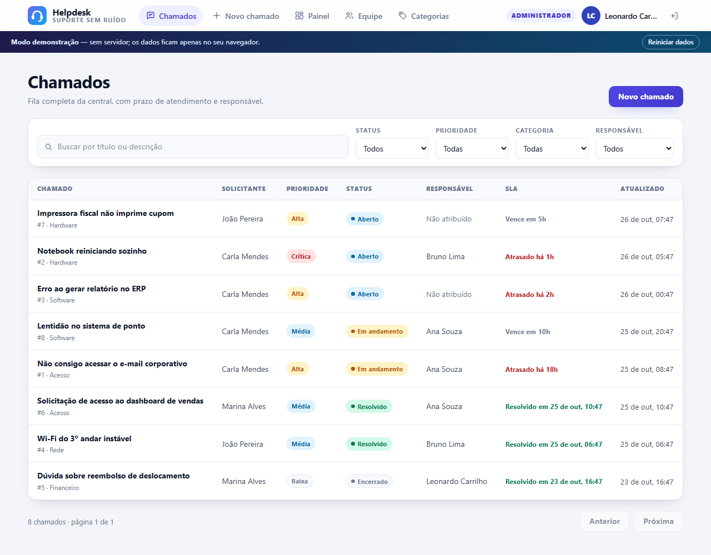

# helpdesk-fullstack

[](https://github.com/LeonardoCarrilho/helpdesk-fullstack/actions/workflows/ci.yml)
[](https://github.com/LeonardoCarrilho/helpdesk-fullstack/actions/workflows/deploy.yml)
[](https://leonardocarrilho.github.io/helpdesk-fullstack/)
[](LICENSE)

Central de atendimento full-stack: abertura de chamados, **SLA por prioridade**,
fila com filtros, comentários internos, **controle de acesso por papéis** e painel
de indicadores. A API é em **Node.js + Express + MySQL**; a interface, em
**React + Vite**.



**Demo sem back-end:** https://leonardocarrilho.github.io/helpdesk-fullstack/

O build publicado no GitHub Pages roda em **modo demonstração** — a mesma
interface, as mesmas regras e as mesmas permissões, com os dados no
`sessionStorage` do navegador. Entre com uma das contas listadas na tela.

## Stack

| Camada | Tecnologias |
| --- | --- |
| API | Node.js 20+ · Express 4 · MySQL 8 (`mysql2/promise`) · JWT · `scrypt` · Zod |
| Web | React 18 · Vite 5 · CSS puro (tema claro/escuro) · roteamento por hash |
| Testes | `node:test` + `supertest` (API) · Vitest + `react-dom/server` (web) |
| Infra | Docker Compose (MySQL + API) · GitHub Actions (CI e Pages) |

## Funcionalidades

- **Autenticação** com JWT (8 h por padrão), senha com `scrypt` e sal por usuário.
  O token vai em `Authorization: Bearer` e também em cookie `httpOnly`.
- **Três papéis**: `admin`, `agent` e `requester`, aplicados no serviço — não só
  na interface.
- **Chamados** com título, descrição, prioridade, categoria, solicitante e
  responsável.
- **SLA automático** na abertura e recalculado quando a prioridade muda.
- **Transições de status** validadas por papel: aberto → em andamento →
  resolvido → encerrado, com reabertura.
- **Comentários públicos e notas internas** — notas internas nunca aparecem para
  o solicitante.
- **Fila com busca e filtros** por status, prioridade, categoria e responsável,
  com paginação no servidor.
- **Painel** com totais por status, distribuição por prioridade, chamados
  atrasados, sem responsável, tempo médio de resolução e carga por agente.
- **Categorias** com cor, criação, edição e exclusão (administrador).
- **Equipe** com promoção/rebaixamento de papéis, impedindo remover o último
  administrador.
- **Interface responsiva** (tabelas viram cartões no mobile), acessível por
  teclado, com foco visível, `aria-*`, `prefers-reduced-motion` e tema escuro
  automático.

## Perfis e permissões

| Ação | Solicitante | Agente | Administrador |
| --- | :---: | :---: | :---: |
| Abrir chamado | ✅ | ✅ | ✅ |
| Ver os próprios chamados | ✅ | ✅ | ✅ |
| Ver a fila completa | — | ✅ | ✅ |
| Editar título/descrição | próprios | ✅ | ✅ |
| Alterar prioridade, responsável e categoria | — | ✅ | ✅ |
| Assumir chamado | — | ✅ | ✅ |
| Comentário público | próprios | ✅ | ✅ |
| Nota interna | — | ✅ | ✅ |
| Resolver e encerrar | próprios, após resolvido | ✅ | ✅ |
| Painel de indicadores | — | ✅ | ✅ |
| Gerenciar categorias | — | — | ✅ |
| Gerenciar papéis | — | — | ✅ |
| Excluir chamado | — | — | ✅ |

### SLA por prioridade

| Prioridade | Prazo |
| --- | --- |
| Crítica | 4 horas |
| Alta | 8 horas |
| Média | 24 horas |
| Baixa | 72 horas |

O prazo é calculado na criação (`due_at`) e recalculado a partir da data de
abertura quando a prioridade muda. Chamados resolvidos ou encerrados deixam de
contar como atrasados.

## Como rodar

### Modo demonstração (sem servidor)

```bash
npm ci
npm run build:demo
npm run preview --workspace web
```

Acesse `http://localhost:4174/helpdesk-fullstack/` (o Vite usa a base
`/helpdesk-fullstack/`, igual ao GitHub Pages). Os dados ficam no
`sessionStorage` e são descartados ao fechar a aba; o botão **Reiniciar dados**
volta ao cenário inicial.

### Aplicação completa (MySQL local)

Pré-requisitos: Node.js 20.19+ e MySQL 8.

```bash
npm ci

# banco e usuário (ajuste se já tiver um MySQL)
mysql -u root -p -e "CREATE DATABASE helpdesk CHARACTER SET utf8mb4 COLLATE utf8mb4_unicode_ci;
CREATE USER 'helpdesk'@'localhost' IDENTIFIED BY 'helpdesk';
GRANT ALL PRIVILEGES ON helpdesk.* TO 'helpdesk'@'localhost';"

cp server/.env.example server/.env   # ajuste JWT_SECRET e credenciais
node --env-file=server/.env server/src/db/migrate.js
node --env-file=server/.env server/src/db/seed.js

# em dois terminais
node --env-file=server/.env server/src/server.js   # API em :3000
npm run dev --workspace web                        # interface em :5174
```

Sem `--env-file`, exporte as variáveis (`PORT`, `JWT_SECRET`, `DB_*`) no shell.
O Vite encaminha `/api` para `http://localhost:3000`.

### Com Docker

```bash
docker compose up --build
docker compose exec api node server/src/db/seed.js
```

MySQL na porta **3307** (para não conflitar com um MySQL local) e API em
`http://localhost:3000`. A API aplica a migração automaticamente antes de subir.

### Contas do seed

| Papel | E-mail | Senha |
| --- | --- | --- |
| Administrador | `admin@helpdesk.dev` | `admin12345` |
| Agente | `ana@helpdesk.dev` | `agente12345` |
| Solicitante | `cliente@helpdesk.dev` | `cliente12345` |

O modo demonstração também aceita `bruno@helpdesk.dev` (agente) e
`joao@helpdesk.dev` / `marina@helpdesk.dev` (solicitantes), todos com
`cliente12345`.

## API

Tudo abaixo de `/api` exige autenticação, exceto `/health` e as rotas de
`/auth`.

| Método | Rota | Descrição |
| --- | --- | --- |
| `GET` | `/api/health` | Status do serviço (público) |
| `POST` | `/api/auth/register` | Cria conta como solicitante e devolve token |
| `POST` | `/api/auth/login` | Autentica e devolve token |
| `POST` | `/api/auth/logout` | Limpa o cookie de sessão |
| `GET` | `/api/me` | Usuário autenticado |
| `GET` | `/api/tickets` | Lista com filtros e paginação |
| `POST` | `/api/tickets` | Abre chamado |
| `GET` | `/api/tickets/:id` | Detalhe do chamado |
| `PATCH` | `/api/tickets/:id` | Atualiza texto, status, prioridade, categoria ou responsável |
| `DELETE` | `/api/tickets/:id` | Remove chamado (admin) |
| `GET` | `/api/tickets/:id/comments` | Comentários visíveis para o usuário |
| `POST` | `/api/tickets/:id/comments` | Comentário público ou nota interna |
| `GET` | `/api/categories` | Lista categorias |
| `POST` | `/api/categories` | Cria categoria (admin) |
| `PATCH` | `/api/categories/:id` | Edita categoria (admin) |
| `DELETE` | `/api/categories/:id` | Remove categoria (admin) |
| `GET` | `/api/users` | Equipe (admin vê todos) |
| `PATCH` | `/api/users/:id/role` | Altera papel (admin) |
| `GET` | `/api/dashboard` | Indicadores (equipe) |

As respostas seguem `{ "data": ... }` com `meta` nas listagens e
`{ "error": "...", "details": [...] }` nos erros. A listagem de chamados envia
também `X-Total-Count`, `X-Page` e `X-Page-Size`.

Filtros de `/api/tickets`: `status`, `priority`, `categoryId`, `assigneeId`
(`me` ou `unassigned`), `q`, `page` e `limit`.

O arquivo [`requests.http`](requests.http) traz exemplos prontos para VS Code
REST Client ou JetBrains HTTP Client.

## Testes

```bash
npm test                 # 116 testes (35 da API + 81 da web)
npm run test:coverage --workspace server
```

- **API (35):** autenticação, RBAC, validação, paginação, transições, SLA,
  comentários internos, indicadores, categorias, usuários, JWT, `scrypt` e datas.
  Os testes rodam contra o repositório em memória — sem MySQL e sem Docker.
- **Web (81):** rótulos e permissões, cálculo de SLA, rotas por hash, contratos
  da camada de demonstração (incluindo persistência e isolamento por papel) e
  renderização dos componentes com `renderToStaticMarkup`.

## Decisões de projeto

### Duas implementações de repositório

`server/src/repositories/mysql.js` contém o SQL real e `memory.js` implementa a
mesma interface em memória. O serviço não sabe qual está por trás: os testes são
rápidos e o ambiente de desenvolvimento não exige banco.

### Autorização no serviço

As regras de quem pode ver, editar, comentar e excluir ficam em
`ticketService.js`, não nos componentes. A interface esconde o que o usuário não
pode fazer, mas a API recusa a operação de qualquer forma — inclusive quando a
requisição é feita à mão.

### Camada de demonstração

`web/src/api/demo.js` replica os contratos da API (envelope, códigos de erro,
transições, SLA, permissões e notas internas) e persiste em `sessionStorage`.
Isso permite publicar no GitHub Pages sem back-end sem transformar o projeto em
uma tela estática: as ações realmente alteram o estado e respeitam os papéis.

Dois clientes (`http.js` e `demo.js`) expõem a mesma interface; `api/index.js`
escolhe um deles conforme `VITE_DEMO`.

### Roteamento por hash

`#/chamados/12` funciona no GitHub Pages sem regra de reescrita e sem adicionar
uma biblioteca de rotas. As rotas são puras e testadas em `lib/rotas.js`.

### Senhas e tokens

`scrypt` com sal de 16 bytes e comparação em tempo constante. O login executa um
hash fictício quando o e-mail não existe, para não revelar quais contas estão
cadastradas pelo tempo de resposta. Em produção, a API se recusa a iniciar com o
segredo de desenvolvimento.

### Interface

Sem framework de CSS: variáveis CSS, grid/flex e um único arquivo com tema claro
e escuro. As tabelas viram cartões abaixo de 760 px, os formulários usam
`label` de verdade, os estados de erro usam `role="alert"` e o menu tem link
para pular ao conteúdo.

## Estrutura

```
.
├── server/
│   ├── sql/schema.sql           # tabelas InnoDB, FKs e índices
│   ├── src/
│   │   ├── app.js               # Express + middlewares
│   │   ├── server.js            # bootstrap e encerramento gracioso
│   │   ├── config/env.js        # ambiente validado com Zod
│   │   ├── db/                  # pool, migrate e seed
│   │   ├── http/schemas.js      # validação das entradas
│   │   ├── middlewares/         # auth, validação, erros
│   │   ├── repositories/        # mysql e memória
│   │   ├── routes/              # auth, tickets, categories, users, dashboard
│   │   ├── services/            # regras de negócio
│   │   └── utils/               # jwt, password, datas, erros
│   └── tests/
├── web/
│   ├── src/
│   │   ├── api/                 # cliente HTTP, camada demo e fábrica
│   │   ├── components/          # telas e componentes
│   │   ├── lib/                 # rótulos, SLA, rotas e erros
│   │   ├── App.jsx
│   │   └── styles.css
│   └── tests/
├── docs/preview.png
├── Dockerfile
├── docker-compose.yml
└── requests.http
```

## Deploy

- `ci.yml`: roda os 116 testes e os dois builds (normal e demonstração) em cada
  push e pull request.
- `deploy.yml`: roda os testes, gera o build com `VITE_DEMO=true` e publica
  `web/dist` no GitHub Pages.

A base do Vite é `/helpdesk-fullstack/`, então o build funciona tanto em
`localhost` quanto no caminho do projeto no Pages.

## Limitações e próximos passos

- Sem refresh token: expirado o token, é necessário entrar novamente.
- Sem rate limit nas rotas de autenticação.
- Sem anexos, notificações por e-mail ou histórico de auditoria.
- Sem testes de integração com um MySQL real no CI; o `docker compose` cobre o
  fluxo completo manualmente.
- Evoluções naturais: anexos, etiquetas, base de conhecimento e relatórios por
  período.

## Licença

[MIT](LICENSE) © Leonardo Fernandes Carrilho
