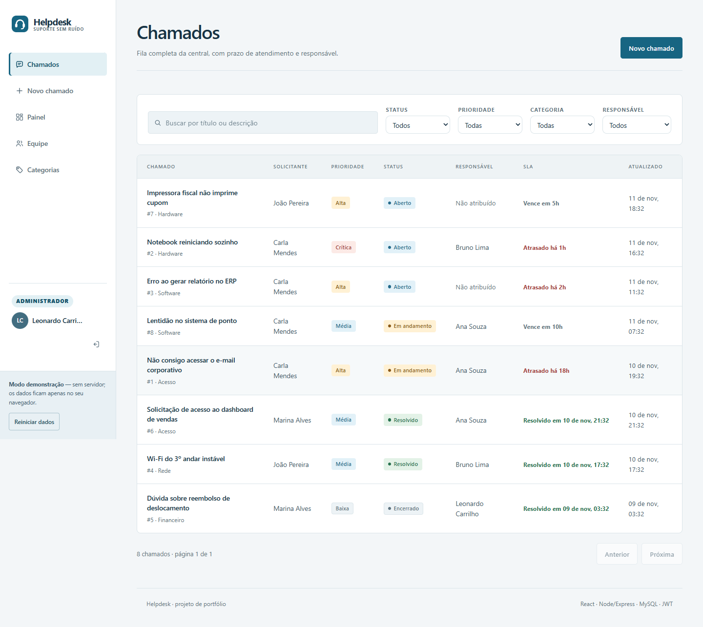
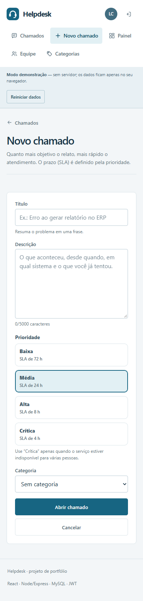

# Verificação da interface

Rodada de novembro de 2026, sobre a branch do PR de segurança existente. A referência anterior foi capturada em `main`; ela não representa a base exata do diff deste PR.

## Telas e estados

Login e cadastro; lista e filtros; painel; novo chamado; detalhe e edição; equipe; categorias e edição. A apresentação também cobre mensagens de carregamento, erro e ausência de resultados. Os diálogos nativos de confirmação continuam sob controle dos componentes existentes.

O navegador verificou todas essas rotas do demo em 390 e 1440 px, cadastro com validação, busca vazia, edição de chamado e categoria, tema escuro e restrição de administração para solicitante. A suíte responsiva também cobre 320 e 768 px. O demo já existia; não foi criado um modo de autenticação alternativo para produção. Falhas de rede e todos os estados transitórios não receberam capturas individuais.

## Evidência

- Build de produção e build do demo passaram; lint passou.
- 40 testes do servidor e 81 do cliente passaram. Cobertura de linhas: 92,58% no servidor e 64,92% no cliente.
- 10 testes de navegador passaram novamente após a correção de foco e da hierarquia do login móvel.
- `npm audit`: nenhuma vulnerabilidade. Overrides restritos de cobertura e atualização compatível do Sentry preservam os gates existentes.
- [CI da implementação](https://github.com/LeonardoCarrilho/helpdesk-fullstack/actions/runs/43127463837): passou. Os testes locais do servidor usam o repositório em memória; o demo não comprova persistência MySQL.

As imagens abaixo usam os dados fictícios do demo existente.

## Checker visual

O checker isolado de layout terminou com erro interno (`r.sections is not iterable`); não foi tratado como aprovação nem repetido. O gate completo da skill executou e apontou 20 achados na primeira rodada. Foco removido do conteúdo e títulos móveis de tamanho igual foram corrigidos e os testes de navegador repetidos. A rodada final permanece pendente.

O aplicativo mantém formulários e tabelas na mesma tela. Não foram inseridos heróis de uma tela inteira, fotografias ou efeitos de rolagem nas tarefas de atendimento apenas para satisfazer critérios de landing page. Logs, perfis e capturas extensas ficam em `.taste-skill/`, fora do Git.
